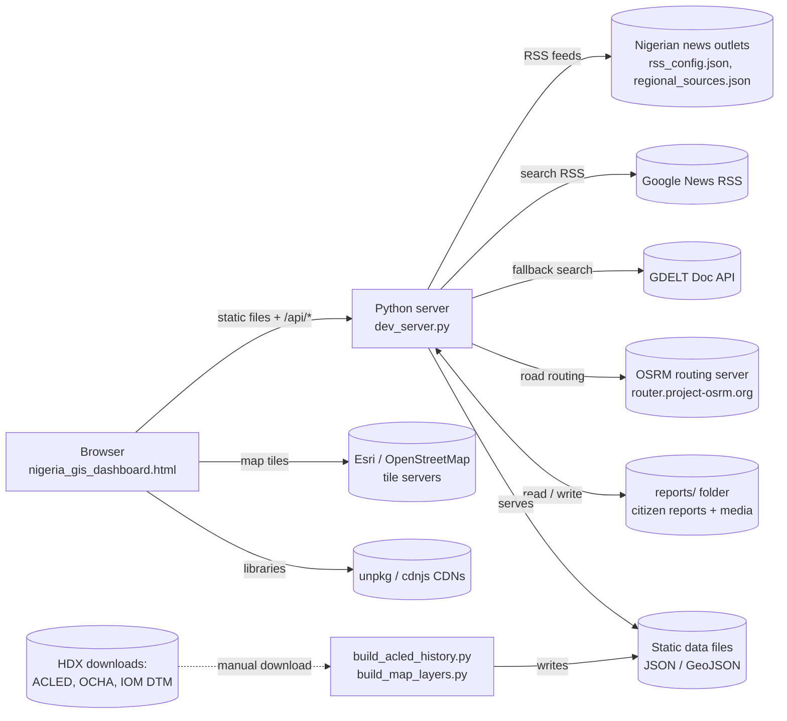
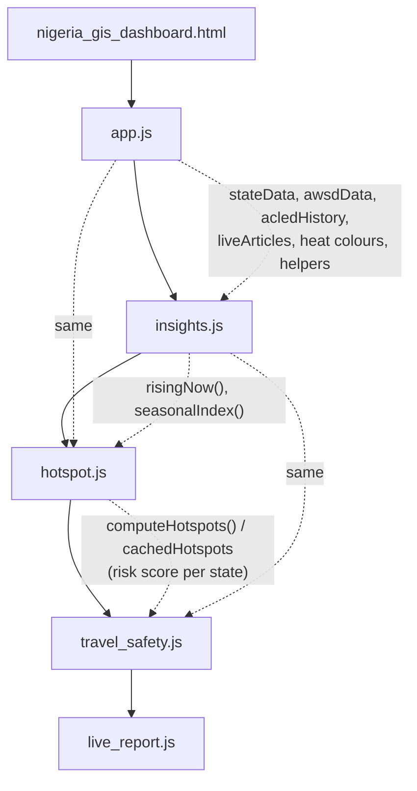
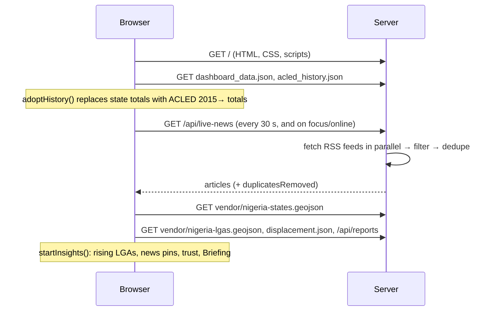

# GeoSentry NG — Technical Architecture

GeoSentry NG is a security-intelligence dashboard for Nigeria. It combines
historical conflict data (ACLED), aid-worker security records (AWSD), live news
from Nigerian outlets and citizen reports into four views: **Dashboard**,
**Hotspot Analysis**, **Travel Safety** and **Live Report**.

This document explains how the pieces fit together. Endpoint details, file
formats and algorithms are in [TECHNICAL_REFERENCE.md](TECHNICAL_REFERENCE.md);
running it in production is in [DEPLOYMENT.md](DEPLOYMENT.md).

---

## 1. At a glance

| Layer | Technology | Notes |
|---|---|---|
| Front end | Plain HTML, CSS and JavaScript (no framework, no build step) | One page: `nigeria_gis_dashboard.html` |
| Mapping | Leaflet 1.9.4, Leaflet.markercluster 1.5.3 | Loaded from unpkg CDN |
| Charts | Chart.js 4.4.1 | Loaded from cdnjs CDN |
| Icons | Tabler Icons 3.19 | Vendored in `vendor/tabler-icons/` |
| Back end | Python 3 standard library only (`http.server`) | `dev_server.py` + `route_news.py` + `route_roads.py` |
| Storage | Static JSON files; citizen reports on disk in `reports/` | No database |
| Data builds | Python scripts (need `openpyxl`) | Run by hand when refreshing data |

There is **no package manager, bundler or test suite**. Files are served as they
are on disk.

---

## 2. System context

* **Browser → server.** Everything the page needs comes from the same server:
  the HTML, scripts, data files and the `/api/*` endpoints.
* **Server → internet.** The server fetches news and road routes on the
  browser's behalf, and caches them, so the browser never calls those services
  directly. That avoids cross-origin problems and keeps rate limits under control.
* **Browser → internet.** Map tiles and the three JavaScript libraries come from
  public CDNs and tile servers.
* **Offline data pipeline.** Historical data is refreshed by downloading files
  from the Humanitarian Data Exchange (HDX) and running two scripts. The
  dashboard itself never calls HDX.

---

## 3. Components

### 3.1 Server (`dev_server.py`)

A `ThreadingHTTPServer` with one request handler (`DashboardHandler`) that:

1. **Serves static files** from the project folder. `/` maps to
   `nigeria_gis_dashboard.html`. Requests under `/reports/` are refused (403) so
   uploaded media is only reachable through the API.
2. **Answers the API** (full list in the technical reference):
   * `GET /api/live-news`: the live news feed. It reads the RSS feeds in
     `rss_config.json`, falls back to GDELT, and then to the cached CSV snapshot.
     Repeated stories are merged (`dedupe_articles`).
   * `GET /api/rss-news`: the RSS part only, without fallbacks.
   * `GET /api/route-news`: news for a set of states and towns, used by Travel
     Safety and by each state's profile in Hotspot (implemented in `route_news.py`).
   * `GET /api/road-route`: the real road between towns, via OSRM
     (`route_roads.py`).
   * `POST /api/submit-report`: citizen reports (multipart form, with media).
   * `GET /api/reports` and `GET /api/reports/{id}/media/{file}`: read reports.
   * `PUT` and `DELETE` on `/api/reports/{id}`: edit or delete a report. These
     need an admin token, or are allowed only from localhost.
3. **Adds headers** to every response: CORS `*` and `Cache-Control: no-store`.

Abuse controls: a per-IP sliding-window rate limit on report submission
(20 per 10 minutes by default), an 80 MB request limit, at most 10 files per
report, and sanitised file names.

### 3.2 Front end

One HTML page, five scripts loaded in this order. They share globals: all are
classic scripts, so top-level `let`/`const`/`function` declarations are visible
across files.

| File | Lines | Responsibility |
|---|---|---|
| `app.js` | ~2,300 | Loads data; live news polling; shared helpers; **Dashboard** view (map, layers, KPI cards, charts, filters, legend, Reset view); view switching; theme; reports viewer |
| `insights.js` | ~520 | Rising-now detection, reading headlines into incidents, trust levels, seasons, Briefing panel, watchlist and alerts |
| `hotspot.js` | ~1,440 | **Hotspot Analysis**: composite risk index, density map, side panel tabs (Risk, Actors, Trend, Seasons, Live signals, Ranking, State profile), CSV export |
| `travel_safety.js` | ~1,550 | **Travel Safety**: road network of corridors, route planning, risk scoring, hourly risk curve, recommendations, route news, basemaps, bus parks |
| `live_report.js` | ~500 | **Live Report** modal: location, category, severity, media upload, camera recording, submission |
| `styles.css` | ~1,700 | All styling. Dark theme by default; light theme via `[data-theme="light"]` |

`initDashboard()` in `app.js` is one large function. Most Dashboard map logic
lives inside it as closures, and the functions that inline `onclick` handlers
need are copied onto `window` with `Object.assign(window, {...})`.

### 3.3 Data files (served as static files)

| File | Built by | Used for |
|---|---|---|
| `dashboard_data.json` | Hand-maintained | State list and centroids, fallback state totals, AWSD aid-worker records, checkpoints |
| `acled_history.json` | `build_acled_history.py` | ACLED events and fatalities by state × month (2015 →), yearly totals per LGA, last 24 months per LGA |
| `displacement.json` | `build_map_layers.py` | Displaced people (IDPs) per LGA, IOM DTM |
| `vendor/nigeria-lgas.geojson` | `build_map_layers.py` | Simplified outlines and centres of the 774 LGAs (OCHA) |
| `vendor/nigeria-states.geojson` | Pre-existing | State outlines |
| `bus_parks.json` | Pre-existing (OpenStreetMap) | Motor parks for Travel Safety bus mode |
| `rss_config.json` | Hand-maintained | Live news feeds and keyword filters |
| `news_config.json` | Hand-maintained | GDELT fallback query |
| `regional_sources.json` | Hand-maintained | 117 outlets by zone and state, for route and state news |
| `live_rss_news_export.csv`, `live_rss_analysis.json` | Static snapshot | Cached news shown when every live source fails; the CSV is also the topbar download |

---

## 4. Key flows

### 4.1 Page load (Dashboard)

### 4.2 Live news → map, charts, briefing

1. `loadLiveNews()` polls `/api/live-news` every 30 seconds (10 seconds while
   retrying after a failure).
2. `renderLiveNews()` turns each article into an incident with
   `extractNewsIncident()`: place (state, plus the LGA where one is named),
   type, people killed or abducted, and trust level.
3. The News list, map pins, "+n live" marks in the state ranking, incident-type
   chart, Briefing, watchlist alerts and the Hotspot risk index all refresh from
   the same article list.

### 4.3 Hotspot risk index → Travel Safety

`computeHotspots()` (hotspot.js) scores every state from 0 to 100 using recent
ACLED deaths and incidents, aid-worker incidents, people affected and live
signals. Travel Safety reads the same scores through `tvStateScore()` as the
baseline risk for each state a route crosses, then adds segment risk, time of
day and route news (`/api/route-news`).

### 4.4 Citizen report

`live_report.js` → `POST /api/submit-report` (multipart) → the server writes
`reports/{id}/meta.json` plus the media files. The reports viewer, the Hotspot
live signals and the news trust check read the reports back through
`GET /api/reports`.

---

## 5. Cross-cutting design decisions

* **No build step.** The project is deliberately framework-free so it can be
  served from any static host plus the small Python server. The cost is large
  files and shared globals; see the refactoring notes in [HANDOFF.md](HANDOFF.md).
* **Server as proxy and cache.** News and routing go through the server, with
  in-memory caches: about 10 minutes for route news and 24 hours for routes.
  Restarting the server clears the caches.
* **One colour scale.** `HEAT_STOPS` in `app.js` (blue → grey → orange → red)
  drives every intensity colour: bubbles, shading, charts, hotspot levels and
  seasons. Change it in one place.
* **Plain-language output.** Figures read from headlines are labelled "not
  verified", and the trust level is shown beside every news incident.
* **Graceful degradation.**
  * No `acled_history.json`: stored totals are used.
  * No LGA file: incidents are placed at state level.
  * No live news: the cached snapshot is shown.
  * No routing server: built-in corridor lines are used.
