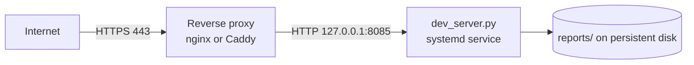

# GeoSentry NG — Running and Deploying

## 1. Run it locally

You need **Python 3.10 or newer**. The server uses only the standard library.

```bash
python dev_server.py --host 127.0.0.1 --port 8085
```

Open <http://127.0.0.1:8085>. On Windows you can double-click
`start_dashboard.bat` instead, or run `dev_server.ps1` (which binds to all
interfaces by default).

Notes:

* Leave the terminal open: closing it stops the server.
* `--host 0.0.0.0` makes the dashboard reachable from other machines on the
  network. Read §3 first.
* The page needs internet access for map tiles, the CDN libraries and live news.

### Optional: the data-refresh scripts

```bash
python -m pip install -r requirements.txt
```

`requirements.txt` lists `openpyxl`, which only the data-refresh scripts need
(see [DATA_SOURCES.md](DATA_SOURCES.md#refreshing-the-data)).

---

## 2. Production deployment (recommended shape)

`dev_server.py` is a small threaded server from Python's standard library. It
handles the expected load for an internal tool. However, it has **no HTTPS, no
access logs in a standard format and no process supervision**, so put it
behind a reverse proxy and run it as a service.



### 2.1 Service (Linux, systemd) — template

```ini
# /etc/systemd/system/geosentry.service
[Unit]
Description=GeoSentry NG dashboard
After=network-online.target

[Service]
User=geosentry
WorkingDirectory=/opt/geosentry
ExecStart=/usr/bin/python3 dev_server.py --host 127.0.0.1 --port 8085
Environment=DASHBOARD_ADMIN_TOKEN=change-me-to-a-long-random-value
Environment=DASHBOARD_SUBMIT_RATE_MAX=20
Environment=DASHBOARD_SUBMIT_RATE_WINDOW=600
Restart=always

[Install]
WantedBy=multi-user.target
```

### 2.2 Reverse proxy (nginx) — template

```nginx
server {
    listen 443 ssl http2;
    server_name dashboard.example.org;
    # ssl_certificate / ssl_certificate_key …

    client_max_body_size 80m;          # matches MAX_REPORT_BYTES

    location / {
        proxy_pass http://127.0.0.1:8085;
        proxy_set_header Host $host;
        proxy_set_header X-Forwarded-For $proxy_add_x_forwarded_for;
        proxy_read_timeout 60s;        # route news can take ~10–20 s on a cold cache
    }
}
```

Both are templates. They have not been tested against a real host, so adjust
paths, users and domain names.

### 2.3 Persistent data

* `reports/` holds citizen reports and their media. Put it on persistent
  storage, back it up, and treat it as personal data.
* Everything else in the folder can be redeployed from Git.

---

## 3. Security checklist before going public

Fix these first. The details are in [HANDOFF.md](HANDOFF.md#1-must-fix-before-public-launch).

- [ ] **Protect `GET /api/reports` and the media URLs.** Today anyone who can
      reach the server can read every citizen report, with locations and photos.
- [ ] **Always set `DASHBOARD_ADMIN_TOKEN`** behind a proxy. Without it the
      server trusts "localhost". Behind a proxy every request comes from
      localhost, so anyone could edit or delete reports.
- [ ] **Teach the server the real client IP** (`X-Forwarded-For`) so the
      submission rate limit is per visitor, not one shared limit for everyone.
- [ ] **Send the admin token from the Reports viewer**, or edit and delete will
      fail once the token is set.
- [ ] **Narrow CORS** from `*` to the dashboard's own origin.
- [ ] **Replace public demo services** for production traffic: the OSRM demo
      server and tile.openstreetmap.org (see DATA_SOURCES.md).
- [ ] **Serve over HTTPS only.** The camera and location features in Live
      Report need a secure context in browsers.

---

## 4. Static hosting

The front end alone (HTML, CSS, JS, JSON and GeoJSON) could be put on any
static host or CDN, but the four views need the API for:

* live news;
* routes;
* route news;
* citizen reports.

Without the Python server:

* The Dashboard and Hotspot still draw from the historical data.
* Live news shows as unavailable.
* Travel Safety and Live Report do not work.

---

## 5. Operations

| Task | How |
|---|---|
| Restart | `systemctl restart geosentry` (clears the in-memory news and route caches) |
| Health check | `GET /api/live-news` should return 200 with `articles` |
| A news feed is failing | `warnings` in `/api/live-news` names it; edit or remove it in `rss_config.json` |
| Refresh ACLED / LGA / displacement data | See DATA_SOURCES.md; commit the regenerated JSON files |
| Rotate the admin token | Change `DASHBOARD_ADMIN_TOKEN` and restart |
| Clear test reports | Delete folders under `reports/` (back them up first) |
